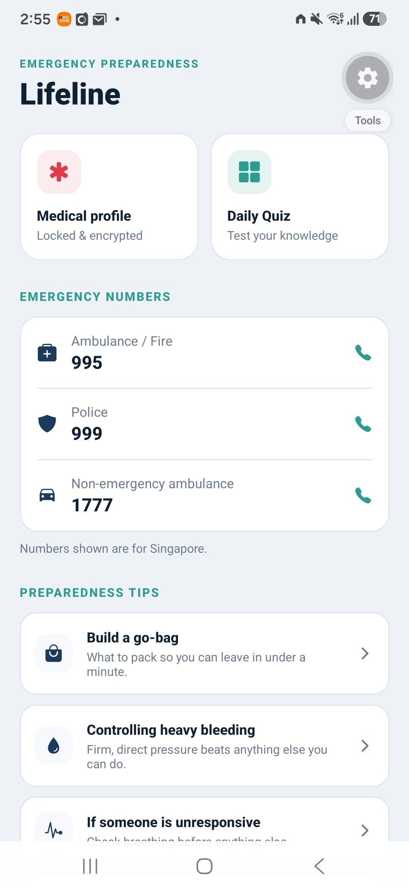
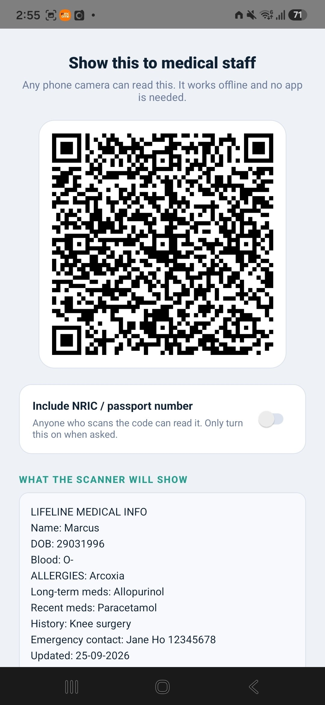
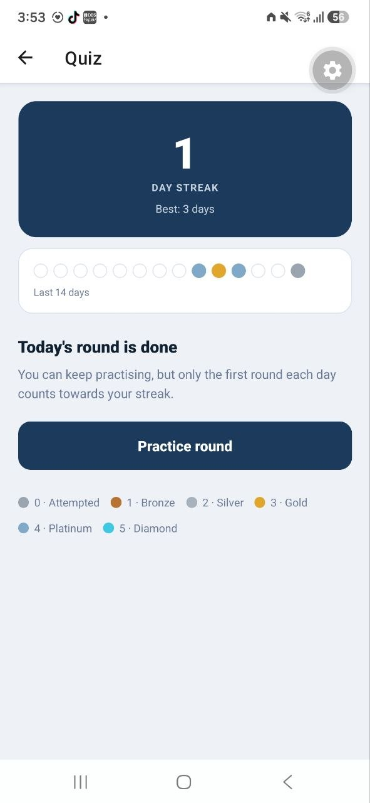

# Lifeline

Emergency preparedness and a medical ID that works offline.

Back when i was serving my National Service as an EMT for SCDF, I saw that First responders, are verbally trying to extract information out of a patient. But what if the first responder is having difficulty communicating to the patient due to a language barrier, or the patient is unconscious ? 

This is where LifeLine is born, it allows members of the public to store critical medical information about themselves, and produces a QR code for the first responder to scan, and quickly retrieve crucial information, which can not only help them with their diagnosis, but save precious seconds which can be the different between life and death.






## Features

### Medical ID

- Stores your profile on device: blood type, allergies, medications, history, emergency contact

- Shows it as a QR code that any phone camera can read, offline

- Encrypted storage using Expo SecureStore

- Biometric or passcode unlock using Expo Local Authentication

- Auto locks whenever you leave the screen

- NRIC / passport number is off by default in the QR code. You opt in with a toggle

- Warns you before the QR code gets too dense to scan reliably

- Tap to call for your emergency contact

### Daily preparedness quiz

- 31 question bank covering Singapore emergencies, first aid, and general preparedness

- 5 questions per round, with explanations after each answer

- Adaptive selection: questions you got wrong come back first, then unseen ones

- Daily streak tracking, a 14 day history view, and score tiers from Attempted to Diamond

- Only the first round each day counts towards your streak. After that it's practice

### Quick reference

- One tap Singapore emergency numbers (995, 999, 1777)

- Preparedness tips: go bag, bleeding control, unresponsive casualty, meeting points, documents, power outages

## Tech stack

| Area           | Tools                           |
| -------------- | ------------------------------- |
| Framework      | React Native, Expo              |
| Navigation     | React Navigation (native stack) |
| Secure storage | expo-secure-store               |
| Authentication | expo-local-authentication       |
| QR codes       | react-native-qrcode-svg         |
| Quiz data      | AsyncStorage                    |
| Language       | JavaScript                      |

## Getting started

``` bash
git clone https://github.com/Mehkox/LifeLine.git 
cd Lifeline
npm install
npx expo start
```

## Design decisions

- Plain text QR payload. The QR holds readable text, not a link or app specific code. Any camera app can show it with no install, which is the point in an emergency.

- Privacy by default. The ID number is excluded unless you turn it on, because anyone who scans the code can read everything in it.

- Offline first. Nothing leaves the device. There is no backend and no account.

- Adaptive quiz. Wrong answers resurface sooner, so practice goes where it's needed.

## Known limitations

- The QR code is not encrypted. Anyone who scans it can read what's in it. The profile is encrypted at rest and behind biometrics, but the QR itself is plain text by design.

- The profile locks when you leave the screen, but not yet when the app is sent to the background.

- Quiz content is written for Singapore. Emergency numbers and guidance differ elsewhere.

- This app is a preparedness aid, not medical advice.

## Author
Marcus Seet BSc (Hons) Computer Science, University of London (via SIM) 
LinkedIn: https://www.linkedin.com/in/marcus-seet-b8946b241 | GitHub: https://github.com/Mehkox